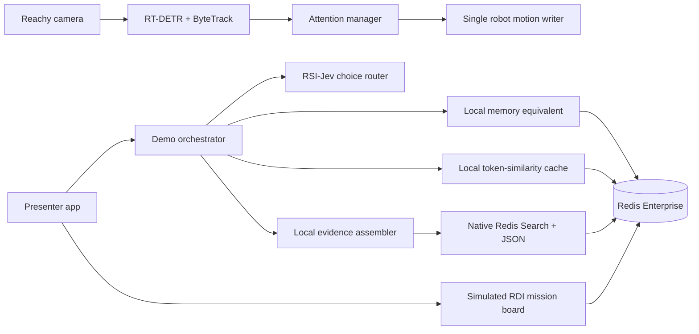

# Reachy Mini: Redis Iris Mission Control

A presenter-led, 25-minute story for Reachy Mini Lite. One Redis Enterprise container runs native Redis JSON and Search. The robot and the presenter app run on the Mac. Agent Memory, LangCache, and Context Retriever have clearly labelled local equivalents and separate native adapter files. The RDI scene is a **simulated direct Redis write**: there is no PostgreSQL, CDC, or RDI service in this demo.

The repository contains source and safe configuration placeholders only. It does not include credentials, model weights, participant facts, or camera recordings. Start with mock mode; physical robot, hosted models, and managed Iris services are optional. See [architecture](docs/architecture.md), [operations](docs/operations.md), and [open checks](OPEN_TASKS.md).

## Run locally

Prerequisites: Docker Desktop, Python 3.12, and a Mac with enough free memory for the optional vision and router models. Run from this directory:

```bash
python3.12 -m venv .venv
.venv/bin/python -m pip install -e '.[vision,test]'
docker compose up -d
.venv/bin/python -m components.redis_enterprise.bootstrap
cp .env.example .env
set -a; source .env; set +a
.venv/bin/uvicorn app:app --host 127.0.0.1 --port 8765
```

Open `http://127.0.0.1:8765`. The bootstrap creates a local cluster and database, and keeps its generated admin credential in the ignored `.secrets/enterprise-admin.json` file (mode 0600). Compose binds all ports to localhost. The database is on port 12000; management UI is on 18443. Never paste the credential into a deck, Git, or the presenter screen.

By default the app uses a mock robot, presenter text, a deterministic routing fallback, and an answer template. **Audio is muted during testing by default**, including Reachy's speaker and browser narration; the presenter shows `Speaker: MUTED`. Set `DEMO_MUTE_ROBOT=false` for a voiced presentation. Microphone input remains available for checks. Click **Simulate three people** to rehearse handoff without the hardware. The status cards show what actually ran. To start another event after deletion, change `DEMO_EVENT_ID` and restart the app.

### Optional local RSI-Jev decision model

The router uses a [typed choice model](https://github.com/Shanghua-Gao/RSI-Jev/blob/main/serve/README.md), not a generative model. This checkout was verified with RSI-Jev source commit `5ac6dcd601e75538a146629d7d1b2ba8fd4d456b` and the [0.8B v1.0 checkpoint](https://huggingface.co/shgao/rsi-jev-v1.0-qwen3.5-0.8b). The model and source stay in ignored `.cache/`:

```bash
mkdir -p .cache
git clone https://github.com/Shanghua-Gao/RSI-Jev.git .cache/RSI-Jev
git -C .cache/RSI-Jev checkout 5ac6dcd601e75538a146629d7d1b2ba8fd4d456b
.venv/bin/python -m pip install -r .cache/RSI-Jev/requirements.txt
.venv/bin/hf download shgao/rsi-jev-v1.0-qwen3.5-0.8b --local-dir .cache/jev-checkpoint
cd .cache/RSI-Jev
../../.venv/bin/python scripts/serve.py --ckpt ../jev-checkpoint --device mps --port 18081
```

In the presenter app's shell, set `DEMO_ROUTER_MODE=jev` and `DEMO_JEV_URL=http://127.0.0.1:18081` before starting Uvicorn. Use `--device cpu` if MPS is unavailable. The router shows the model's choice and applies a visible explicit-intent guardrail when a clear memory, search, status, or finale request is misclassified. The five scripted prompts were tested against this local service; a blank-frame detector plus router latency probe measured 0.17 seconds median after warmup on this Mac. That probe says nothing about real people or motor response. Run `DEMO_JEV_URL=http://127.0.0.1:18081 .venv/bin/python scripts/benchmark_rehearsal.py` during rehearsal.

### Reachy Mini Lite and speech

Set `DEMO_ROBOT_MODE=physical`, `DEMO_VISION_MODE=rtdetr`, and optionally `DEMO_AUDIENCE_ROI=0.08,0.15,0.92,0.95` (left, top, right, bottom as fractions of the camera frame). The [Reachy SDK](https://github.com/pollen-robotics/reachy_mini/blob/main/docs/source/SDK/python-sdk.md) supplies camera frames, calibrated image-to-head geometry, antenna and body targets, and audio I/O. The app disables Reachy's built-in one-face tracker while its own RT-DETR R18 plus ByteTrack controller owns head motion. It keeps one target through the answer, waits briefly on loss, returns to neutral, and offers **Select next** and **Skip**. Track IDs are temporary; no frame is saved or used to identify a person.

`HF_ASR_URL`, `HF_ANSWER_URL`, `HF_ANSWER_MODEL`, and `HF_API_TOKEN` configure optional Hugging Face speech recognition and chat answer deployments. Speech output uses `HF_TTS_URL` when supplied, or the [OpenAI Speech API](https://developers.openai.com/api/docs/guides/text-to-speech) with `OPENAI_API_KEY` (the local `openai_secret` variable is also accepted). The physical robot mode sends synthesized speech to the MacBook's built-in speakers. Without recognition, the presenter can type; browser narration is available only when the testing mute is turned off and remains explicitly labelled. For registration, the volunteer can speak the name and fact into the robot when ASR is configured, the presenter triggers a readback, then confirms consent before storage. If an opt-in participant is selected for a later question, the presenter must confirm that person said their name in that conversation. The camera never assigns names.

## The 25-minute story

| Time | Scene | Presenter action | What the audience sees |
| --- | --- | --- | --- |
| Before / 0–3 min | Meet Reachy | Ask two or three volunteers for a name and one safe fact; read back, confirm, store | Event-scoped opt-in memory |
| 3–6 min | Where should this go? | Let Reachy select, face, and wave to a person; ask a question | RSI-Jev choice or labelled rules fallback |
| 6–9 min | Do you remember me? | Ask a named volunteer to identify themselves and ask for their fact | Participant-specific recall |
| 9–12 min | Have I heard this before? | Ask the same public FAQ twice | Local cache miss, then hit |
| 12–16 min | Find the rule | Ask for the priority delivery rule | Native Search/JSON result and cited evidence |
| 16–20 min | The world changed | Set station CLOSED; immediately ask for its status | Direct Redis write, labelled simulated RDI |
| 20–25 min | Put it together | Move to another volunteer and ask the finale prompt | Fact + cited priority rule + current CLOSED status |

The stage strip in the app carries the suggested script and prompts. Finish with **End event and delete its data**. The local store also expires event keys after 24 hours as a backstop.

## Architecture and boundaries



Every component is in `components/<name>/`, with a matching `.agents/skills/<name>/SKILL.md`. `AGENTS.md` routes agent work; `contracts/models.py` holds shared events and response shapes. `OPEN_TASKS.md` lists unmet service and physical-hardware acceptance checks. `components/agent_memory/native.py`, `components/langcache/native.py`, and `components/context_retriever/native.py` are separate native integration paths. They are deliberately inactive until service access and event deletion are verified.

## Current Iris service availability

As of 30 September 2026, Redis documentation describes self-managed [Agent Memory](https://redis.io/docs/latest/operate/iris/agent-memory/self-managed/), [LangCache](https://redis.io/docs/latest/operate/iris/langcache/self-managed/), and [Context Retriever](https://redis.io/docs/latest/operate/iris/context-retriever/self-managed/) on Kubernetes. Confirm current availability, licensing, and deployment requirements before using them. The one Enterprise container is a Redis database, not those Iris services.

Placeholders live in `.env.example`: Agent Memory data-plane URL/store ID/key; LangCache data-plane URL/cache ID/key; Context Retriever MCP URL/agent key. The MCP URL identifies the Context Retriever service; this demo does not need a separate surface ID. Once supplied, validate service health, actual API calls, access scope, and event-end deletion before enabling or relabelling a native path. Keep secrets only in local environment variables or an external secret store.

## Checks

```bash
.venv/bin/pytest -q
```

The focused tests cover participant handoff and loss, JEV HTTP parsing/guardrail, and the full Redis story including memory isolation, cache hit/miss, cited retrieval, live board updates, and event-end deletion. The Redis test skips when the local database is absent; a passing skip is not integration evidence. The browser and physical acceptance probe remain separately tracked in `OPEN_TASKS.md`.
